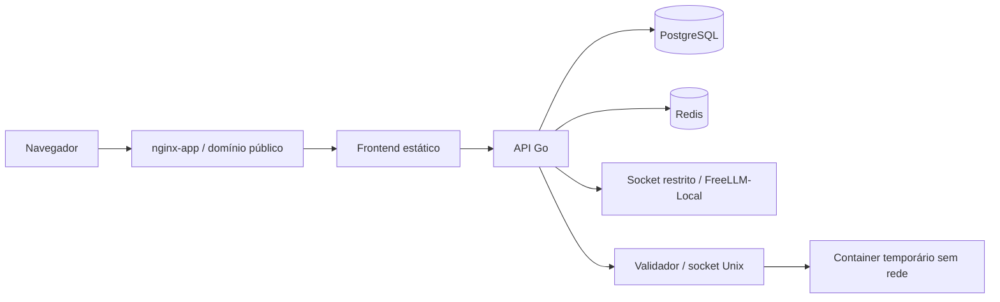

# CodeCrashReview 0.2.0

Arena web de revisão de repositórios com duas análises independentes, avaliação por IA ou operador e evidências persistidas em PostgreSQL.

Aplicação: https://codecrashreview.laytech.com.br

## Fluxo operacional

1. Criar conta e indicar um GitHub público ou um repositório Git local autorizado.
2. Escolher objetivo, arquivos de foco, especialidade e dois perfis distintos.
3. O servidor clona uma revisão identificada por SHA e inicia as duas inferências concorrentemente pelo FreeLLM-Local.
4. Cada proposta deve entregar achados, alteração exata, topologia, design, implantação, critérios de aprovação, objetivo, metodologia e limitações das evidências.
5. O servidor gera e verifica o patch. Quando há um perfil de aceitação compatível, compila e executa testes isolados. Uma falha pode ser devolvida ao agente para até três tentativas; provas e patches anteriores ficam registrados.
6. O avaliador só pode selecionar uma proposta com prova funcional aprovada. A aplicabilidade do patch sozinha não libera uma vitória.
7. O veredito e as pontuações são gravados no banco; o patch vencedor pode ser baixado pela interface.

## Escopo e limites desta versão

- O perfil executável `arena-grade-v1` cobre `backend/internal/arena/grade.go`: compilação, sinais, zero, pontuação parcial, inteiros grandes, funções permitidas e entradas inválidas. Ele usa testes mantidos pelo projeto, não testes inventados pelo agente.
- Outros repositórios e arquivos podem ser analisados, mas permanecem sem aprovação funcional até existir um perfil de aceitação correspondente. Não representam entregas prontas para implantação.
- Os dois agentes são chamadas independentes ao modelo configurado, com papéis distintos. O filtro por especialidade é uma política de seleção de perfis, não uma comprovação de capacidades de modelos diferentes.
- A interface exporta o patch. Publicar automaticamente no GitHub, criar release de um repositório arbitrário ou implantar a proposta no destino ainda não são funcionalidades da interface.
- Arquivos/contexto são limitados. O resultado não equivale a uma auditoria exaustiva de todo o repositório.
- As telas anteriores estão preservadas em `frontend/legacy`; os protótipos de execução antigos, em `legacy/backend`. Não fazem parte da aplicação publicada.

## Infraestrutura



PostgreSQL e Redis não publicam portas no host. O backend não recebe o socket Docker. O broker de validação recebe acesso ao daemon e constitui uma fronteira privilegiada: não aceita imagem, comando, teste ou caminho de montagem enviados pelo cliente. Executa somente o perfil fixo. O container de prova não recebe segredos nem sockets e usa usuário sem privilégios, raiz somente leitura, limites de memória/processos/CPU e nenhuma rede. O limite de execução protege recursos; não atribui pontos por velocidade.

## Instalação no host existente

Preservar `.env`, volumes, banco, proxy FreeLLM e `nginx-app`. Definir `VALIDATOR_IMAGE` com o digest imutável de uma imagem Go previamente baixada e compatível com o projeto; exemplo em `.env.example`. O Compose monta somente `/opt/laytech-ai/repositories` como origem local permitida, em leitura. Não montar todo `/opt/laytech-ai`.

```sh
docker compose -f compose.host.yml build
docker compose -f compose.host.yml up -d
docker compose -f compose.host.yml ps
```

O proxy do host usa `/opt/laytech-ai/volumes/nginx/nginx.conf` e o destino `codecrash-frontend:80` na rede `CNC_APP_PROD_01`. Não substituir os demais servidores virtuais. Antes de qualquer recarga, executar `docker exec nginx-app nginx -t`.

## Validação reproduzível

### Host externo isolado

Para validar fora do host de produção, use preferencialmente Linux x86_64 (Ubuntu 22.04/24.04 ou Debian 12) com Docker Engine e Compose v2. O mínimo prático é 4 vCPUs, 16 GB de RAM e 50 GB livres em SSD; para duas inferências locais simultâneas, prefira 8 vCPUs, 32 GB e 100 GB. Windows 11 também é suportado via Docker Desktop + WSL2. Não é necessário expor portas à Internet: a instalação publica somente `127.0.0.1:18080` e mantém PostgreSQL, Redis e o broker sem portas públicas.

O host precisa de saída HTTPS (`443`) para clonar o repositório e baixar imagens. GPU NVIDIA não é requisito quando `FREELLM_BASE_URL` aponta para um endpoint OpenAI-compatible acessível pelo host; é opcional para executar Ollama localmente (recomenda-se 8 GB de VRAM). A validação de publicação exige, adicionalmente, um token GitHub temporário com `Contents: Read and write` no repositório de teste. O token não é gravado pelo instalador. Não são necessários SSH, RDP, Tailscale, DNS público ou acesso administrativo ao host de produção.

Em Linux, a instalação completa da pilha isolada é:

```sh
curl -fsSL https://raw.githubusercontent.com/verissimodf/CodeCrashReview/Develop/scripts/install-validation.sh \
  -o /tmp/ccr-install.sh && bash /tmp/ccr-install.sh --dir "$HOME/CodeCrashReview-validation"
```

Em Windows PowerShell (Docker Desktop + WSL2):

```powershell
irm https://raw.githubusercontent.com/verissimodf/CodeCrashReview/Develop/scripts/install-validation.ps1 -OutFile $env:TEMP\ccr-install.ps1
powershell -ExecutionPolicy Bypass -File $env:TEMP\ccr-install.ps1
```

O comando cria um `.env.validation` privado, baixa a branch `Develop`, constrói backend/frontend/validador, aplica as migrações e confirma a página em `http://127.0.0.1:18080`. Para usar o FreeLLM já disponível no host, passe `--freellm-url http://host.docker.internal:8082/v1`; sem um endpoint de inferência, a instalação ainda comprova a infraestrutura e os testes do validador, mas não uma partida completa de IA. Para remover tudo depois da prova: `docker compose --env-file .env.validation -f compose.validation.yml down -v` dentro do diretório criado.

```sh
cd backend
go test -race ./...
go vet ./...
go run golang.org/x/vuln/cmd/govulncheck@latest ./...
cd ../frontend
pnpm install --frozen-lockfile
pnpm check
pnpm test
pnpm build
pnpm audit --prod
cd ..
python3 scripts/verify-grade-proofs.py
python3 scripts/verify-review-e2e.py
cd frontend
pnpm exec playwright test
```

Os dois scripts operacionais exigem o host configurado, Docker e inferência real. O segundo cria uma conta de teste e um repositório de reprodução explicitamente identificado, contendo o defeito da proposta anterior. Ele não afirma que esse defeito existia no código original. As credenciais ficam em arquivo privado ignorado pelo Git. Resultados, hashes e capturas ficam em `artifacts/validation`. O teste de navegador usa a conta e o resultado gerados por esse roteiro. `CCR_BASE_URL` e `CCR_CHROMIUM` podem selecionar domínio e navegador.

Não confundir testes unitários ou saúde de containers com essa prova operacional. O CI executa checagem, testes e compilação; as provas com o modelo real precisam ser executadas no ambiente integrado.
